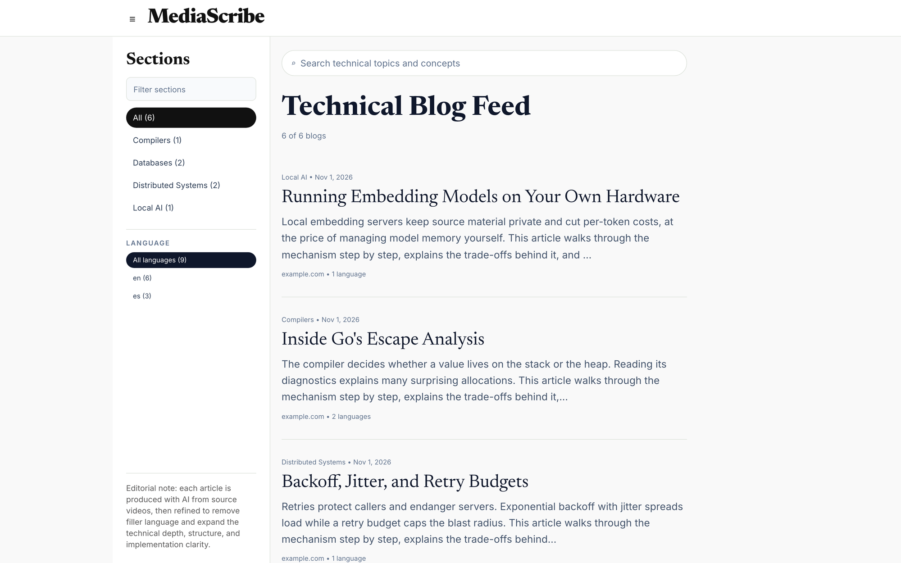
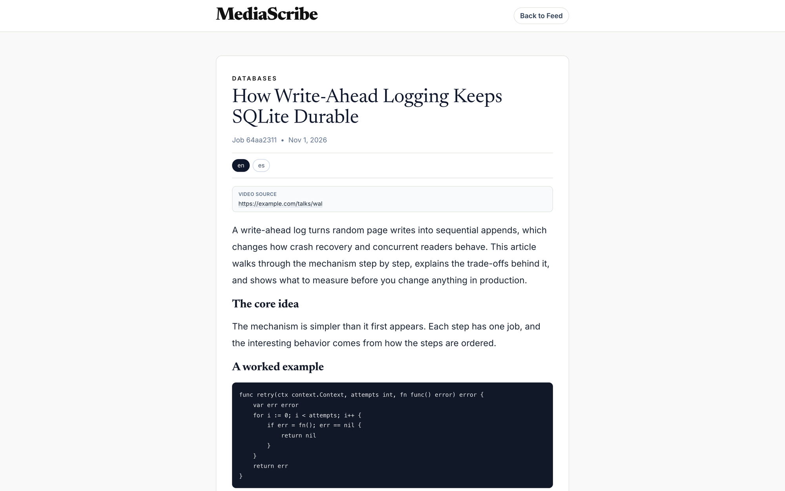
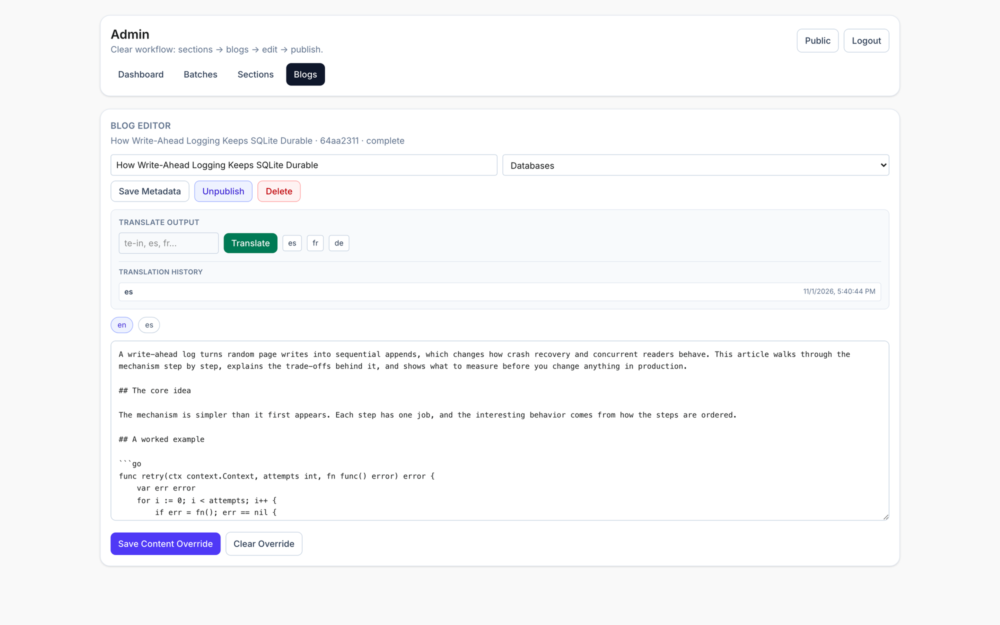
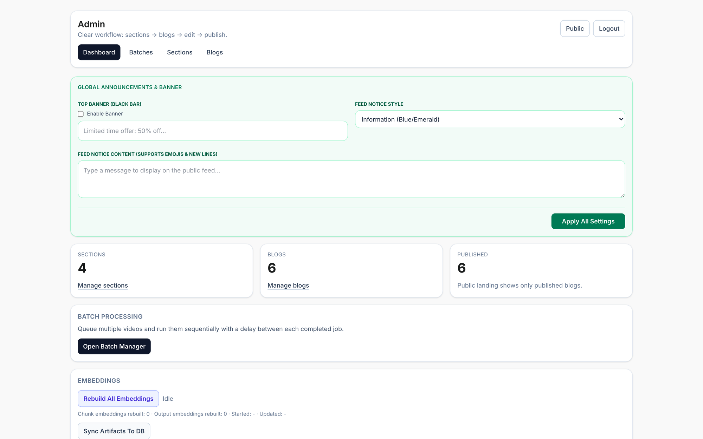
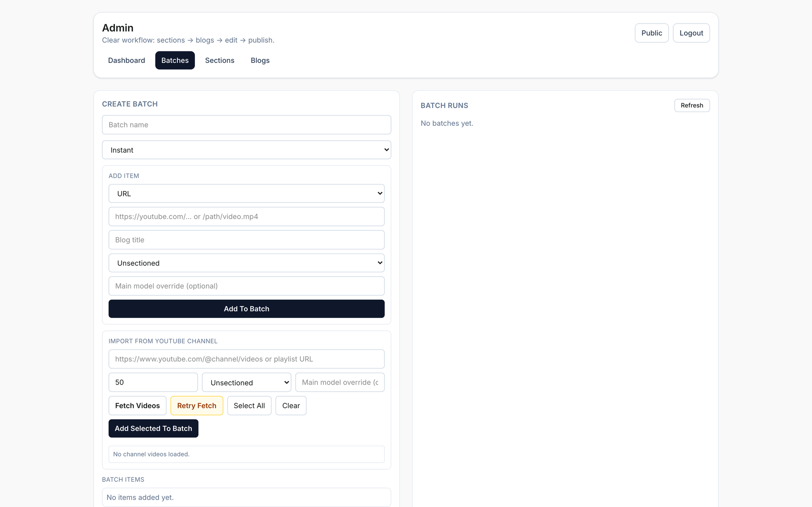

<p align="center">
  <picture>
    <source media="(prefers-color-scheme: dark)" srcset="docs/brand/icon-dark.svg">
    
  </picture>
</p>

<h1 align="center">MediaScribe</h1>

<p align="center">
  <b>Local-first video-to-blog publishing; a Go pipeline that turns technical videos into searchable, multilingual articles with self-hosted models.</b>
</p>

<p align="center">
  Give it a video URL or a local file, and it transcribes, analyzes, writes, and optionally translates a structured engineering article, ready to review and publish from a built-in admin.<br>
  <i>By Brian Nunez.</i>
</p>

<p align="center">
  
  
  
  
  <br>
  <a href="https://github.com/brian-nunez/mediascribe/releases"></a>
  <a href="go.mod"></a>
</p>

<p align="center">
  <a href="#quick-start"></a>
</p>

<p align="center">
  <a href="#quick-start"><b>Quick start</b></a> ·
  <a href="#docker-deployment">Docker</a> ·
  <a href="#api-reference">API reference</a> ·
  <a href="https://github.com/brian-nunez/mediascribe/releases">Releases</a>
</p>

<br>

<p align="center">
  
  <br><sub><b>Public feed</b>: published articles with section and language filters and search, shown here with sample content.</sub>
</p>

> [!NOTE]
> **MediaScribe is self-hosted.** There is no public demo instance, so run it locally or with Docker to try it. Follow the **[quick start](#quick-start)** to set it up.

<p align="center">
  <a href="#why-mediascribe">Why MediaScribe</a> ·
  <a href="#how-it-works">How it works</a> ·
  <a href="#quick-start">Quick start</a> ·
  <a href="#docker-deployment">Docker</a> ·
  <a href="#environment-variables">Environment</a> ·
  <a href="#api-reference">API</a> ·
  <a href="#license">License</a>
</p>

## Why MediaScribe

- **Self-hosted.** Models, transcripts, and articles stay on infrastructure you run. Metadata lives in SQLite and every job keeps its artifacts on disk.
- **Flexible.** Writing, embeddings, and translation each have their own model and host, so one workstation or several GPU boxes both work. Any job can override the defaults.
- **Recoverable.** Each stage is tracked, each stage's output is saved, interrupted jobs and batches pick back up at startup, and failed jobs can be retried.
- **Reviewable.** Generated articles stay private until you publish them, and you can correct the markdown for any language first.

## How it works

Each job runs these stages in order and writes its output to its own artifact directory.

| Stage | What it does | Output |
| ----- | ------------ | ------ |
| **Download or copy** | Fetches the URL with `yt-dlp` or copies a local file. | `source.mp4` |
| **Extract audio** | Pulls the audio track with FFmpeg. | `audio.wav` |
| **Transcribe** | Runs `whisper-cli`, or uses the fallback transcript when configured. | `transcript.json` |
| **Chunk** | Splits the transcript into chunks. | `chunks.json` |
| **Embed** | Generates chunk embeddings for search. | SQLite rows |
| **Analyze** | Runs the main model over each chunk. | `analysis.json` |
| **Outline** | Plans the article from the analysis and transcript. | `outline.md` |
| **Draft** | Writes the first version. | `draft.md` |
| **Refine** | Produces the final markdown. | `final.md` |
| **Translate** | Translates the article when enabled for the job. | `final.<lang>.md` |
| **Complete** | Marks the job complete so the article appears in the admin. | Job status |

## Publishing

The public site is server-rendered and read-only.

| Feature | Description |
| ------- | ----------- |
| **Editorial Feed** | Paginated list of published articles, filterable by section and language. |
| **Hybrid Search** | Combines embedding similarity with exact-word matching, and falls back to word matching when the embedding host is unavailable. |
| **Multilingual Articles** | Readers switch between every language an article has been translated into. |
| **Source Attribution** | Each article links back to its source video. |
| **Installable App** | A web manifest and service worker let the site install as a progressive web app. |

## Administration

The admin at `/admin` covers ingestion, editing, and site settings. There is no self-registration; admin users are created from the [CLI](#quick-start).

| Feature | Description |
| ------- | ----------- |
| **Batch Processing** | Queues URLs or local paths and runs them one at a time, with a delay of up to one hour between jobs. |
| **Channel Import** | Lists up to 500 videos from a YouTube channel or playlist URL to add to a batch. |
| **Blog Editor** | Edits title and section, and saves a markdown override per language without touching the original artifact. |
| **Publish Controls** | Publishes, unpublishes, deletes, and restores articles. |
| **On-Demand Translation** | Translates a completed article into a supported locale. |
| **Sections** | Creates, orders, and removes the sections that organize the feed. |
| **Announcements** | Sets a top banner and a styled notice on the public feed. |
| **Maintenance Tools** | Rebuilds all embeddings and syncs artifact metadata into the database. |

## Screenshots

These captures come from a local instance seeded with sample content.

<table>
<tr>
<td width="50%" valign="top"></td>
<td width="50%" valign="top"></td>
</tr>
<tr>
<td width="50%" valign="top"></td>
<td width="50%" valign="top"></td>
</tr>
</table>

## Supported model backends

Base URLs can point at Ollama or llama.cpp servers. The client tries the Ollama endpoints first and falls back automatically when those routes are unavailable.

| Backend | Generation | Embeddings |
| ------- | ---------- | ---------- |
| **Ollama** | `/api/generate` | `/api/embed` |
| llama.cpp legacy | `/completion` | `/embedding` |
| llama.cpp OpenAI-compatible | `/v1/chat/completions` | `/v1/embeddings` |

## Quick start

You need:

- Go 1.25 and a C compiler, because the SQLite driver uses cgo
- [FFmpeg](https://ffmpeg.org/) and [yt-dlp](https://github.com/yt-dlp/yt-dlp)
- The standalone [Tailwind CSS CLI](https://tailwindcss.com/docs/installation) as `tailwindcss`
- An [Ollama](https://ollama.com/) or [llama.cpp](https://github.com/ggml-org/llama.cpp) server

```sh
git clone https://github.com/brian-nunez/mediascribe.git
cd mediascribe

ollama pull gpt-oss:20b                 # main writing model
ollama pull embeddinggemma:300m         # embedding model
ollama pull translategemma:4b           # translation model

make deps-whisper                       # build whisper.cpp and download its base model (macOS)
export MAIN_MODEL_BASE_URL=http://localhost:11434

make admin-create USER=admin PASS='change-this-password'  # create the first admin, 8+ characters
make run                                # start the server on :8080
```

Then open:

- Public site: <http://localhost:8080>
- Admin: <http://localhost:8080/admin>

To process your first video, sign in and open **Batches**, add a URL or local path, and start the batch. When the job finishes, publish the article from **Blogs**.

> [!IMPORTANT]
> The Makefile's default `MAIN_MODEL_BASE_URL` is a private network address, so set it to your own server as shown above. `make deps-whisper` downloads a macOS CMake build. On Linux, build whisper.cpp yourself or use [Docker](#docker-deployment).

### Development

```sh
make dev                                # watch templ, Tailwind, and Go with Air
make build                              # generate assets and build all packages
make env                                # print the configuration Make will use
make run-fresh                          # run while ignoring exported app variables
```

`make dev` needs [Air](https://github.com/air-verse/air). Generated templ files are committed, so Docker builds do not need the templ CLI.

If your shell has conflicting Go variables, for example from `gvm`, run with a clean toolchain path:

```sh
GOROOT=/usr/local/go GOPATH=$HOME/go go run ./cmd/server
```

### Running tests

```sh
go test ./...
```

## Docker deployment

The image bundles the server, the admin CLI, FFmpeg, yt-dlp, whisper.cpp, and the whisper base model. Your model servers run separately.

```sh
cp .env.example .env                    # then set the model names and base URLs
make docker-up                          # build and start the compose stack
make docker-verify-deps                 # confirm ffmpeg, yt-dlp, and whisper in the container
docker compose exec mediascribe admin create-user --username admin --password 'change-this-password'
```

Compose publishes port 8080 and mounts `./data`, `./artifacts`, and `./logs`.

```sh
make docker-logs                        # follow the server logs
make docker-rebuild-embeddings          # rebuild embeddings for all jobs
make docker-down                        # stop the stack
make docker-build-amd64                 # build a linux/amd64 image with buildx
```

For a multi-architecture build, set the image, tag, and platforms directly:

```sh
IMAGE=mediascribe TAG=dev PLATFORMS=linux/amd64,linux/arm64 \
  LOCAL_MULTIARCH=1 LOAD=1 ./scripts/docker_build_multiarch.sh
```

## Environment variables

Defaults below come from the application code. The app does not load `.env` itself; Docker Compose reads it for variable substitution. Durations accept Go syntax such as `90s` or plain seconds.

### Server and storage

| Variable | Default | Effect |
| -------- | ------- | ------ |
| `HTTP_ADDR` | `:8080` | Listen address. |
| `SQLITE_PATH` | `./data/app.db` | SQLite database path. |
| `ARTIFACT_ROOT` | `./artifacts/jobs` | Root directory for job artifacts. |
| `ADMIN_SESSION_TTL` | `72h` | Admin session lifetime. |
| `ADMIN_COOKIE_NAME` | `vtb_admin_session` | Admin session cookie name. |

### Models

| Variable | Default | Effect |
| -------- | ------- | ------ |
| `MAIN_MODEL` | `gpt-oss` | Analysis and writing model. |
| `MAIN_MODEL_BASE_URL` | `http://localhost:11434` | Main model server. |
| `MAIN_MODEL_TIMEOUT` | `30m` | Main model request timeout. |
| `MAIN_MODEL_MAX_RETRIES` | `2` | Main model retry count. |
| `EMBEDDING_MODEL` | `embeddinggemma` | Embedding model. |
| `EMBEDDING_MODEL_BASE_URL` | `http://localhost:11435` | Embedding model server. |
| `EMBEDDING_MODEL_TIMEOUT` | `5m` | Embedding request timeout. |
| `EMBEDDING_MODEL_MAX_RETRIES` | `2` | Embedding retry count. |
| `TRANSLATE_MODEL` | `translategemma` | Translation model. |
| `TRANSLATE_MODEL_BASE_URL` | `http://localhost:11436` | Translation model server. |
| `TRANSLATE_MODEL_TIMEOUT` | `30m` | Translation request timeout. |
| `TRANSLATE_MODEL_MAX_RETRIES` | `2` | Translation retry count. |
| `MODEL_RETRY_BACKOFF` | `10s` | Wait between model retries. |
| `ENABLE_TRANSLATION` | `false` | Default translation setting for new jobs. |

Translation preserves markdown structure by prompt instruction, so results depend on the translation model.

### Media tools

| Variable | Default | Effect |
| -------- | ------- | ------ |
| `FFMPEG_BIN` | `ffmpeg` | FFmpeg binary. |
| `YTDLP_BIN` | `yt-dlp` | yt-dlp binary, used when `source_type=url`. |
| `WHISPER_CPP_BIN` | `./deps/whisper.cpp/build/bin/whisper-cli` | whisper.cpp binary. |
| `WHISPER_MODEL_PATH` | `./deps/whisper.cpp/models/ggml-base.bin` | whisper model file. |
| `TRANSCRIPT_FALLBACK_PATH` | | Text file to use as the transcript, for development without whisper. |

### OpenTelemetry

| Variable | Default | Effect |
| -------- | ------- | ------ |
| `OTEL_ENABLED` | `false` | Turns on tracing and log export. |
| `OTEL_SERVICE_NAME` | `video-to-blog-page` | Reported service name. |
| `OTEL_SERVICE_VERSION` | | Reported service version. |
| `OTEL_ENVIRONMENT` | `development` | Reported environment. |
| `OTEL_EXPORTER_OTLP_ENDPOINT` | `localhost:4317` | OTLP endpoint. |
| `OTEL_EXPORTER_OTLP_INSECURE` | `true` | Connects without TLS. |
| `OTEL_FAIL_FAST` | `false` | Stops startup when telemetry setup fails. |

`docker-compose.yml` does not pass these variables to the container.

### Where defaults differ

The Makefile and Compose file set their own values, which take effect over the code defaults.

| Variable | Makefile | Compose |
| -------- | -------- | ------- |
| `MAIN_MODEL` | `gpt-oss:20b` | `gpt-oss` |
| `MAIN_MODEL_BASE_URL` | `http://10.0.0.119:11434` | `http://host.docker.internal:11434` |
| `EMBEDDING_MODEL` | `embeddinggemma:300m` | `embeddinggemma` |
| `EMBEDDING_MODEL_BASE_URL` | `http://localhost:11434` | `http://host.docker.internal:11435` |
| `TRANSLATE_MODEL` | `translategemma:4b` | `translategemma` |
| `TRANSLATE_MODEL_BASE_URL` | `http://localhost:11434` | `http://host.docker.internal:11436` |
| `SQLITE_PATH` | `./data/app.db` | `/app/data/app.db` |
| `ARTIFACT_ROOT` | `./artifacts/jobs` | `/app/artifacts/jobs` |
| `WHISPER_CPP_BIN` | Fixed to the code default | `/opt/whisper/bin/whisper-cli` |
| `WHISPER_MODEL_PATH` | Fixed to the code default | `/opt/whisper/models/ggml-base.bin` |

`.env.example` is a separate starting point with its own model names and a private network host, so update both before using it.

## API reference

Admin routes use the session cookie set by `POST /api/admin/login`.

### Public

| Method | Route | Auth | Description |
| ------ | ----- | ---- | ----------- |
| `GET` | `/api/v1/health` | None | Service health. |
| `GET` | `/api/public/catalog` | None | Published articles grouped by section. |
| `GET` | `/api/public/feed` | None | Paginated feed. Accepts `section_id`, `lang`, `limit` (default 20, max 100), and `offset`. |
| `GET` | `/api/public/blogs/{blog_id}` | None | One published article. |
| `GET` | `/api/search` | None | Search published articles. Accepts `q` and `limit` (default 10, max 50). |
| `GET` | `/api/locales` | None | Supported translation locales. |

### Jobs

| Method | Route | Auth | Description |
| ------ | ----- | ---- | ----------- |
| `POST` | `/api/jobs` | Admin | Create a job. |
| `GET` | `/api/jobs` | None | List jobs. |
| `GET` | `/api/jobs/{job_id}` | None | Get a job. |
| `GET` | `/api/jobs/{job_id}/transcript` | None | Get the transcript. |
| `GET` | `/api/jobs/{job_id}/blog` | None | Get the article. Accepts `lang`. |
| `GET` | `/api/jobs/{job_id}/translations` | None | List translations. |
| `POST` | `/api/jobs/{job_id}/translate` | Admin | Start a translation. Body: `language`. |
| `POST` | `/api/jobs/{job_id}/retry` | Admin | Retry a job. |

`POST /api/jobs` takes `source_type` (`url` or `path`) with `source_url` or `source_path`, plus optional `title`, `main_model`, `main_model_base_url`, `embedding_model`, `embedding_model_base_url`, `translation_model`, `translation_model_base_url`, `translation_enabled`, and `translation_language`.

```sh
curl -c cookies.txt -X POST http://localhost:8080/api/admin/login \
  -H 'Content-Type: application/json' \
  -d '{"username":"admin","password":"change-this-password"}'

curl -b cookies.txt -X POST http://localhost:8080/api/jobs \
  -H 'Content-Type: application/json' \
  -d '{"source_type":"path","source_path":"/videos/talk.mp4","title":"My talk"}'
```

### Admin session

| Method | Route | Auth | Description |
| ------ | ----- | ---- | ----------- |
| `POST` | `/api/admin/login` | None | Sign in. Body: `username`, `password`. |
| `POST` | `/api/admin/logout` | Session cookie | Sign out. |
| `GET` | `/api/admin/me` | Admin | Current admin user. |

### Admin content

| Method | Route | Description |
| ------ | ----- | ----------- |
| `GET` | `/api/admin/catalog` | Full catalog, including unpublished articles. |
| `GET` | `/api/admin/stats` | Dashboard counts. |
| `GET`, `POST` | `/api/admin/sections` | List or create sections. |
| `PUT`, `DELETE` | `/api/admin/sections/{section_id}` | Update or delete a section. |
| `GET`, `PUT`, `DELETE` | `/api/admin/blogs/{blog_id}` | Read, update, or delete an article. |
| `POST` | `/api/admin/blogs/{blog_id}/restore` | Restore a deleted article. |
| `PUT` | `/api/admin/blogs/{blog_id}/section` | Move an article to a section. |
| `PUT` | `/api/admin/blogs/{blog_id}/content` | Save a markdown override. Body: `language`, `markdown`. |
| `PUT` | `/api/admin/blogs/{blog_id}/publish` | Publish or unpublish. Body: `published`. |

### Admin operations

| Method | Route | Description |
| ------ | ----- | ----------- |
| `GET`, `POST` | `/api/admin/batches` | List batches, or create and start one. |
| `GET` | `/api/admin/batches/{batch_id}` | Get a batch and its items. |
| `POST` | `/api/admin/batches/{batch_id}/start` | Start a batch. |
| `POST` | `/api/admin/channel/videos` | List channel videos. Body: `url`, `limit`. |
| `GET`, `POST` | `/api/admin/embeddings/rebuild` | Read rebuild status or start a rebuild. |
| `POST` | `/api/admin/artifacts/sync` | Sync artifact metadata into the database. |
| `GET`, `PUT` | `/api/admin/settings/{key}` | Read or write a global setting. Body: `value`. |

## Tech stack

**Client:** server-rendered [templ](https://templ.guide/) pages, Tailwind CSS, and plain JavaScript

**Server:** Go, [Echo](https://echo.labstack.com/), and [goldmark](https://github.com/yuin/goldmark)

**Data:** SQLite and on-disk job artifacts

**AI and media:** Ollama or llama.cpp, [whisper.cpp](https://github.com/ggml-org/whisper.cpp), FFmpeg, and yt-dlp

**Observability:** OpenTelemetry over OTLP

## License

MediaScribe is licensed under the [MIT License](LICENSE). Copyright (c) 2026 Brian Nunez.
